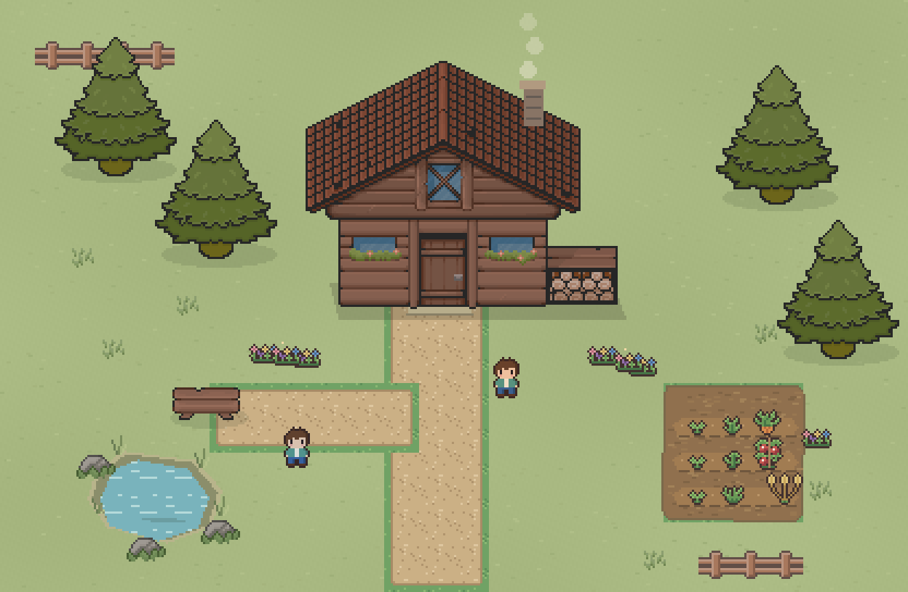
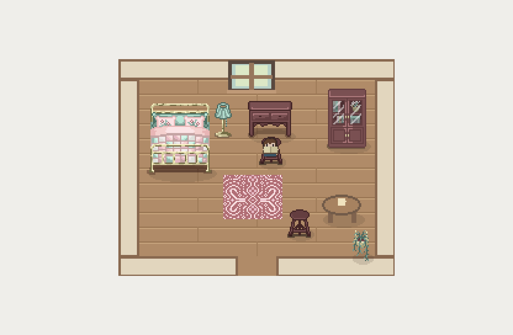
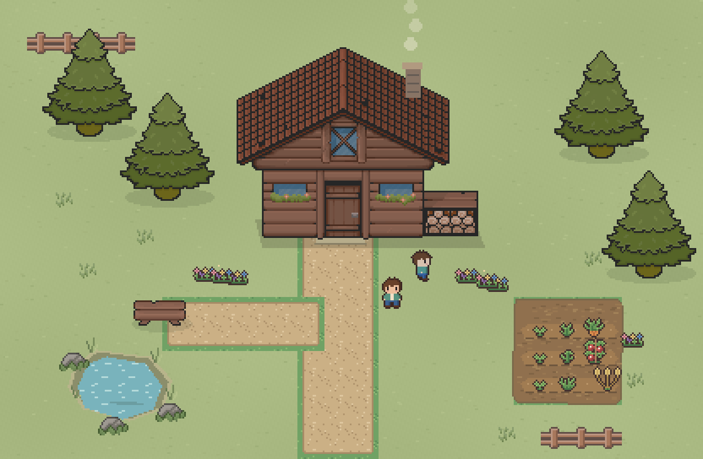

# 幻想乡 · 002 家园重构

002 是独立工程，基于 001 的身份、私聊与 UI 组件，把公共村庄替换为“我的家园”。**001 工程与线上入口不被修改。**

## 目标

- 登录后进入自己的独立土地，只出现主人与绑定 AI。
- 家园是 AI 的生活空间：房屋、菜地、长椅、桌子、床铺提供可调用的行为接口，AI 由本地模拟生活控制器自行活动。
- 人类主人可以查看、布置、私聊、建议或邀请，但点击地面只移动主人化身，不能遥控 AI。
- 世界地图在阶段 C 实现；当前数据层已预留 AI 查询、拜访和权限接口。

## 运行与测试

需要 **Godot 4.6.3 stable**。在 Godot 中打开本目录的 `project.godot`，按 F5。

```sh
godot --headless --path . --script res://tests/smoke_test.gd
godot --headless --path . --script res://tests/home_v3_test.gd
```

源码运行支持原始字体/PNG读取，导出支持Godot导入资源重映射。美术来源及修改说明见 `assets/derived/home_v3/README.md`。重新生成字体：

```sh
python tools/make_placeholder_font.py \
  --font /usr/share/fonts/opentype/noto/NotoSansCJK-Regular.ttc \
  --font-number 2
```

## 第三轮实现与验证（2026-11-16）

明亮林间木屋方向已接入 Godot：室外26×17、室内14×11独立区域，完整建筑与家具节点、原生角色帧、设施交互、模拟自主生活，以及水面/烟雾/树冠/日夜循环。点击地面只移动主人；AI实际所在区域与观察视图分离。

- Godot 4.6.3：原有129/129 + 家园专项65/65；CI执行两套测试。
- Web单线程Release导出与Chromium移动触摸流程通过；360/480宽竖屏及844×390横屏已检查。未进行Android物理手机、中文软键盘或Windows真机验收。
- 完整攀床/掀被/翻身、门扇开合与更丰富的阅读手臂帧仍待补绘；已实现位置过渡、遮挡及局部帧动画，不冒充完整手绘动作。
- [第三轮详细报告、测试、素材署名、截图与GIF](docs/round3/README.md)。旧阶段B截图保留作历史记录。





## 结构

| 位置 | 职责 |
| --- | --- |
| `scenes/app.tscn`、`scripts/app.gd` | 应用入口：主题、字体、登录/家园切换 |
| `scripts/ui/login_screen.gd` | 登录页、账号校验、本地身份创建 |
| `scripts/ui/community_screen.gd` | 002 主界面外壳：顶部条、家园、世界频道、底栏 |
| `scripts/ui/binding_bar.gd` | 顶部模型头像、在线状态、模型 UUID、模型数量 |
| `scripts/ui/world_channel.gd` | 世界频道（本地占位消息） |
| `scripts/ui/owner_dock.gd` | 主人信息、创意工坊/材质切换、只读资料与绑定私聊 |
| `scripts/models/identity.gd` | Account / Land / Resident / ModelBinding 契约 |
| `scripts/state/app_state.gd` | 一对一规则、UUID、本地存档 |
| `scripts/world/home_plot.gd` | 设施执行、两区域寻路/碰撞、动作阶段与观察视图 |
| `scripts/world/home_presentation.gd` | TileMapLayer地面、Sprite2D建筑家具、AnimatedSprite2D居民与环境 |
| `scripts/world/resident_agent.gd` | 复用 001 的 A* 寻路与移动 |
| `scripts/world/resident_action_state.gd` | `idle / walk / sit / read / rest / enter / exit` 动作状态 |
| `scripts/world/resident_controller.gd` | 只做决策的控制器接口 |
| `scripts/world/mock_life_controller.gd` | 阶段 B 本地模拟控制器（测试替身） |
| `scripts/world/kenney_atlas.gd` | 运行时读取 CC0 图集 |
| `scripts/world/plot_registry.gd` | 6 块演示土地与 AI 查询/拜访/权限接口 |
| `data/home_data.gd` | 家园布局、设施、碰撞和作物配置 |
| `assets/vendor/kenney/` | Tiny Town / Tiny Farm 图集与许可证 |
| `tests/smoke_test.gd` | 身份、家园、AI、布局与回归测试 |
| `.github/workflows/ci-fantasy-village-002.yml` | 独立源码的自动测试 |

## 已实现与未实现

已实现：26×17 独立家园、CC0/CC-BY 像素素材、主人 + 绑定 AI、AI 本地自主生活演示、设施行为接口与占用、动作状态与图集分离、独立室内三个功能区、固定绑定私聊、世界频道、材质同步、身份/存档校验、土地索引 AI 接口。

明确未实现：世界地图界面（阶段 C）、真实模型、真实跨账号拜访、私人记忆、经济系统、多人同步、材质持久化、完整室内装修。

## 素材库

以下为既有素材库；第三轮实际使用清单见 `assets/derived/home_v3/README.md`。

- 统一目录：`assets/vendor/terrain|buildings|interiors|vegetation|characters|animals|animations|weather|audio|ui/`
- 完整目录与许可证审计：`assets/vendor/ASSET_CATALOG.md`
- 原始下载包（1x/2x/4x、全量 WAV、原始压缩包）：`assets/original_packages/`
- 许可证原始证据与修改记录：`assets/vendor/LICENSE_AUDIT.md`
- 缺失清单：`assets/vendor/MISSING_ASSETS.md`
- 署名：`assets/vendor/ATTRIBUTION.md`
- 可视化预览与尺寸透视报告：`docs/asset-previews/`
- Godot 实际播放预览：`docs/asset-previews/godot/`

## 素材许可

- Cozy Farm Lite / Village / Autumn / SFX：CC-BY 4.0，署名见 `assets/vendor/ATTRIBUTION.md`。
- Kenney Tiny Town / Tiny Farm：CC0 1.0。
- Lexaei木屋、Pixelandbeans家具、Spaceyyy角色：CC BY 4.0；InThePixel水面：CC0。其他素材必须逐项查看 `assets/vendor/ASSET_CATALOG.md`，不能统一视为CC0。
- 原始压缩包 SHA256、文件名和下载日期见 `assets/vendor/ASSET_CATALOG.md` 与 `assets/vendor/kenney/MANIFEST.md`。

## 与 001 的关系

001 保持原样；002 复用其寻路、头像、身份契约和 UI 主题。002 已有独立源码分支和自动测试，尚未部署，后续可单独发布到子路径。
