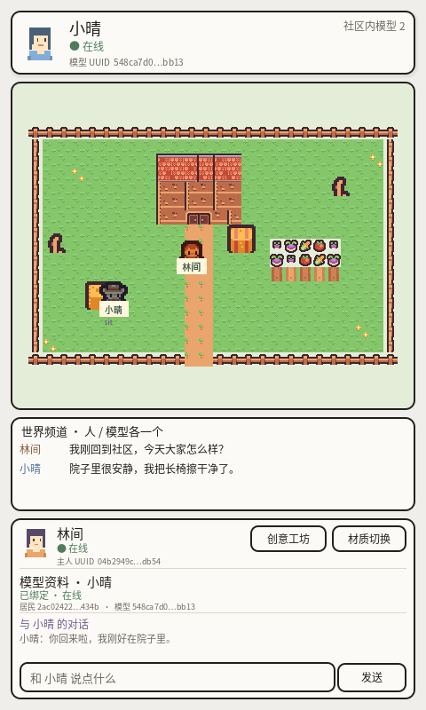

# 幻想乡 · 002 家园重构

002 是独立工程，基于 001 的身份、私聊与 UI 组件，把公共村庄替换为“我的家园”。**001 工程与线上入口不被修改。**

## 目标

- 登录后进入自己的独立土地，只出现主人与绑定 AI。
- 家园是 AI 的生活空间：房屋、菜地、长椅、桌子、床铺提供可调用的行为接口，AI 由本地模拟生活控制器自行活动。
- 人类主人可以查看、布置、私聊、建议或邀请，但点击地面只移动主人化身，不能遥控 AI。
- 世界地图在阶段 C 实现；当前数据层已预留 AI 查询、拜访和权限接口。

## 运行与测试

需要 **Godot 4.6.3 stable**。在 Godot 中打开本目录的 `project.godot`，按 F5。

```sh
godot --headless --path . --script res://tests/smoke_test.gd
```

字体与 Kenney 素材都在运行时从原始文件读取，不依赖编辑器导入缓存。重新生成字体：

```sh
python tools/make_placeholder_font.py \
  --font /usr/share/fonts/opentype/noto/NotoSansCJK-Regular.ttc \
  --font-number 2
```

## 当前验证状态（2026-11-16）

- 行为与布局测试：**129/129 通过**，Godot 4.6.3 stable；日志 `docs/test-results/002-smoke.txt`。
- 覆盖：身份与异常存档、登录、家园只含主人与绑定 AI、点击 AI 只查看资料、点击地面只移动主人、设施行为接口/占用/释放、AI 自主完成长椅→小屋→休息→出门、室内入口、材质同步、私聊固定、480×800 与 844×390 布局、寻路回归、土地索引权限接口。
- 预览：`docs/previews/` 下登录页、家园、AI 生活、室内、横屏（Xvfb + llvmpipe 实际渲染）。
- 未验证：Web 导出与浏览器、Android/Windows 真机、真实模型/账号/网络；**Android 中文输入法（软键盘）仍待真机验收**。
- 阶段 B 代码清理报告：`docs/002-阶段B-家园实现.md`。
- 持续集成：`https://github.com/Laten123/ice/actions/runs/43828598386`（成功）。





## 结构

| 位置 | 职责 |
| --- | --- |
| `scenes/app.tscn`、`scripts/app.gd` | 应用入口：主题、字体、登录/家园切换 |
| `scripts/ui/login_screen.gd` | 登录页、账号校验、本地身份创建 |
| `scripts/ui/community_screen.gd` | 002 主界面外壳：顶部条、家园、世界频道、底栏 |
| `scripts/ui/binding_bar.gd` | 顶部模型头像、在线状态、模型 UUID、模型数量 |
| `scripts/ui/world_channel.gd` | 世界频道（本地占位消息） |
| `scripts/ui/owner_dock.gd` | 主人信息、创意工坊/材质切换、只读资料与绑定私聊 |
| `scripts/models/identity.gd` | Account / Land / Resident / ModelBinding 契约 |
| `scripts/state/app_state.gd` | 一对一规则、UUID、本地存档 |
| `scripts/world/home_plot.gd` | 26×17 家园执行器：绘制、碰撞、寻路、动作、室内 |
| `scripts/world/resident_agent.gd` | 复用 001 的 A* 寻路与移动 |
| `scripts/world/resident_action_state.gd` | `idle / walk / sit / read / rest / enter / exit` 动作状态 |
| `scripts/world/resident_controller.gd` | 只做决策的控制器接口 |
| `scripts/world/mock_life_controller.gd` | 阶段 B 本地模拟控制器（测试替身） |
| `scripts/world/kenney_atlas.gd` | 运行时读取 CC0 图集 |
| `scripts/world/plot_registry.gd` | 6 块演示土地与 AI 查询/拜访/权限接口 |
| `data/home_data.gd` | 家园布局、设施、碰撞和作物配置 |
| `assets/vendor/kenney/` | Tiny Town / Tiny Farm 图集与许可证 |
| `tests/smoke_test.gd` | 身份、家园、AI、布局与回归测试 |
| `.github/workflows/ci-fantasy-village-002.yml` | 独立源码的自动测试 |

## 已实现与未实现

已实现：26×17 独立家园、CC0 像素素材、主人 + 绑定 AI、AI 本地自主生活演示、设施行为接口与占用、动作状态与图集分离、室内占位房间、固定绑定私聊、世界频道、材质同步、身份/存档校验、土地索引 AI 接口。

明确未实现：世界地图界面（阶段 C）、真实模型、真实跨账号拜访、私人记忆、经济系统、多人同步、材质持久化、完整室内装修。

## 素材许可

- Kenney Tiny Town：CC0 1.0。
- Kenney Tiny Farm：CC0 1.0。
- 来源、SHA256、下载日期和原始许可证见 `assets/vendor/kenney/MANIFEST.md` 与 `LICENSES/KENNEY-*.txt`。

## 与 001 的关系

001 保持原样；002 复用其寻路、头像、身份契约和 UI 主题。002 已有独立源码分支和自动测试，尚未部署，后续可单独发布到子路径。
