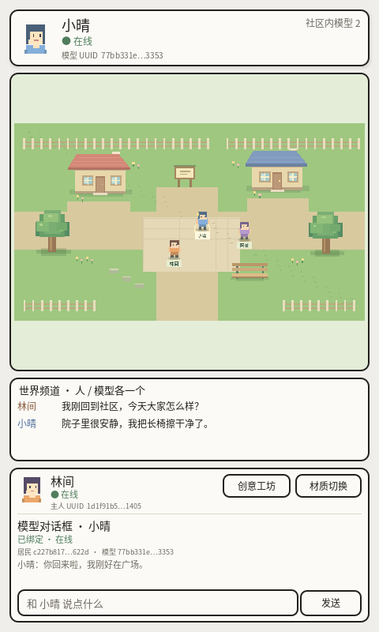
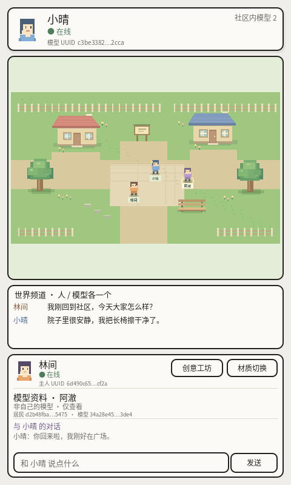
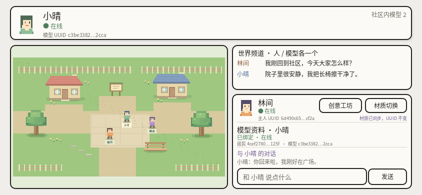

# 幻想乡 · 002 界面重构

002 是独立工程，基于 001 的场景与交互代码，重新组织登录页和社区主界面。**001 工程与线上入口不被修改。**

## 目标

- 登录页：账号入口、绑定模型预览、进入社区。
- 主界面：顶部绑定模型信息、中央社区地图、世界频道、主人功能区、底部模型对话框。
- 数据规则：一个账号、一块土地、一个绑定 AI 居民；居民 UUID 稳定，模型绑定可替换。
- 暂不接入真实模型、账号服务或网络聊天；所有状态为本地占位。

## 运行与测试

需要 **Godot 4.6.3 stable**。在 Godot 中打开本目录的 `project.godot`，按 F5。

```sh
godot --headless --path . --editor --import
godot --headless --path . --script res://tests/smoke_test.gd
```

字体子集需要 FontTools；新文案出现后重新生成：

```sh
python tools/make_placeholder_font.py \
  --font /usr/share/fonts/opentype/noto/NotoSansCJK-Regular.ttc \
  --font-number 2
```

## 当前验证状态（2026-11-16）

- 行为与布局测试：**119/119 通过**，Godot 4.6.3 stable；日志 `docs/test-results/002-smoke.txt`。
- 覆盖：一对一身份规则、UUID 独立性、非法绑定/重复模型 UUID/绑定失败状态不变/身份字段冲突拒绝、登录流程、四个区域、访客只读资料、私聊固定绑定居民、材质与头像同步、出门追踪显隐、480×800 竖屏与 844×390 横屏布局、寻路回归。
- 预览：`docs/previews/` 下登录页、竖屏社区、访客只读资料、材质切换、横屏社区（Xvfb + llvmpipe 实际渲染）。
- 未验证：Android/Windows 真机、Web 导出与浏览器、真实模型/账号/网络；**Android 中文输入法（软键盘）仍待真机验收**。








## 结构

| 位置 | 职责 |
| --- | --- |
| `scenes/app.tscn`、`scripts/app.gd` | 应用入口：主题、字体、登录/社区切换 |
| `scripts/ui/login_screen.gd` | 登录页、账号校验、首次创建提示 |
| `scripts/ui/community_screen.gd` | 002 主界面布局与交互编排 |
| `scripts/ui/binding_bar.gd` | 顶部模型头像、在线状态、模型 UUID、模型数量 |
| `scripts/ui/world_channel.gd` | 世界频道（本地占位消息） |
| `scripts/ui/owner_dock.gd` | 主人信息、创意工坊/材质切换、模型对话框 |
| `scripts/ui/sketch_frame.gd` | 手绘风占位标题框 |
| `scripts/models/identity.gd` | Account / Land / Resident / ModelBinding 契约 |
| `scripts/state/app_state.gd` | 一对一规则、UUID、本地存档 |
| `scripts/services/mock_community_service.gd` | 世界频道、私聊回复、占位提示 |
| `scripts/world/` | 复用 001 的地图、居民与寻路 |
| `tests/smoke_test.gd` | 002 行为、布局与回归测试 |
| `.github/workflows/ci-fantasy-village-002.yml` | 002 源码独立检出后的自动测试 |

## 已实现与占位

已实现：本地登录与存档、严格身份/存档校验、绑定模型信息、地图复用、世界频道两条占位消息、主人功能区入口、访客只读资料、固定绑定居民的私聊、材质切换与头像同步、模型出门状态与追踪按钮显示条件。

明确占位、尚未接入：真实账号/模型/网络、世界频道真实多人消息、模型真实出门与位置追踪、创意工坊、材质持久化、001 的三名居民以外的社区扩展。

## 与 001 的关系

002 复制并扩展了 `scripts/world/`、`data/`、`scripts/ui/avatar.gd` 与字体/构建工具；001 目录保持原样。002 已有独立源码分支和自动测试，尚未部署，后续可单独发布到子路径。
