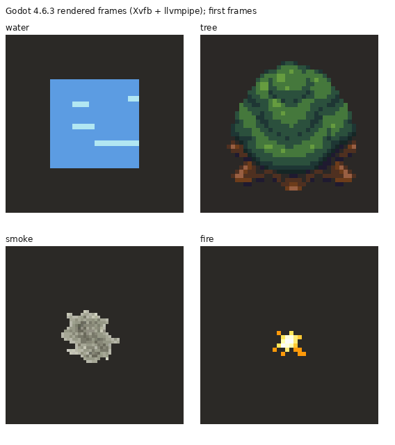

# Godot 实际播放预览

这些 GIF 的每一帧都由 **Godot 4.6.3 stable** 在 SubViewport 中用 `AnimatedSprite2D` 实际渲染，然后拼成 GIF。  
不是用 Pillow 直接读取素材生成的示意图。

## 运行方式

- 渲染器：GL Compatibility / OpenGL 3，Xvfb + llvmpipe；
- 工具：`tools/asset_animation_preview.gd`；
- 256×256 SubViewport，深色背景；
- `AnimatedSprite2D`，最近邻过滤；
- 帧通过 `Image.load_png_from_buffer` 读取原始 PNG，不依赖编辑器导入。

## 结果

| 预览 | 素材与裁切 | 帧数 | 循环 / 速度 |
| --- | --- | ---: | --- |
| `godot-water.gif` | `animated-flowing-water/water_strip13.png` 每帧 16×16 | 13 | 循环，90 ms/帧 |
| `godot-tree.gif` | `animated-tree-and-water/tree_water_sheet.png` 顶部 3 个 32×32 树帧 | 3 | 循环，250 ms/帧 |
| `godot-smoke.gif` | `SmokeLarge_13x1` 44×44 帧 | 13 | 循环，110 ms/帧 |
| `godot-fire.gif` | `FirePlume_17x1` 20×20 帧 | 17 | 一次性；预览 GIF 为方便查看循环播放，80 ms/帧 |

## 检查结论

- 水、树、烟、火都能在 Godot 4.6.3 中正确读出并渲染；
- 树图原始白/洋红背景已在入库前转 alpha，透明像素 RGB 清零，实际播放无白边；
- 烟雾 44×44、火柱 20×20 不是 16px 网格物体，按效果层缩放，不和角色/建筑同倍率硬拼；
- 水条是单格 16×16 纹理，实际地图应平铺，而不是当成一张大图；
- 火焰 17 帧适合一次性播放，烟雾适合循环；
- 原图集仍保留，GIF 只是审查预览。

## 真实运行截图

- 
- 原始单帧 PNG 只用于生成，不提交，避免重复体积。
