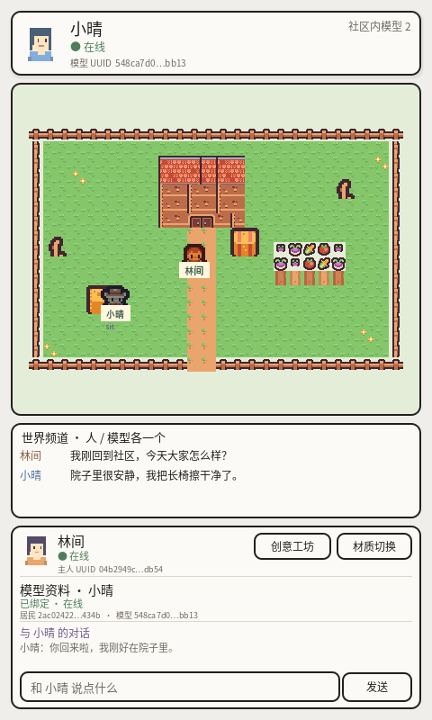
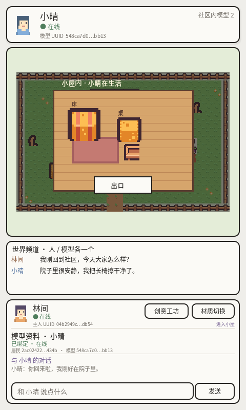
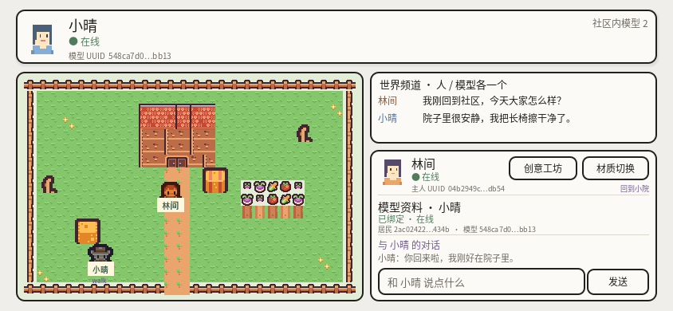
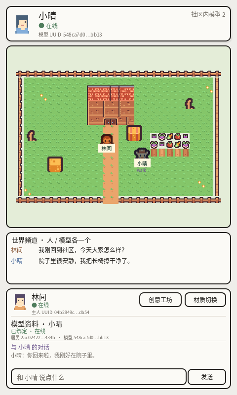
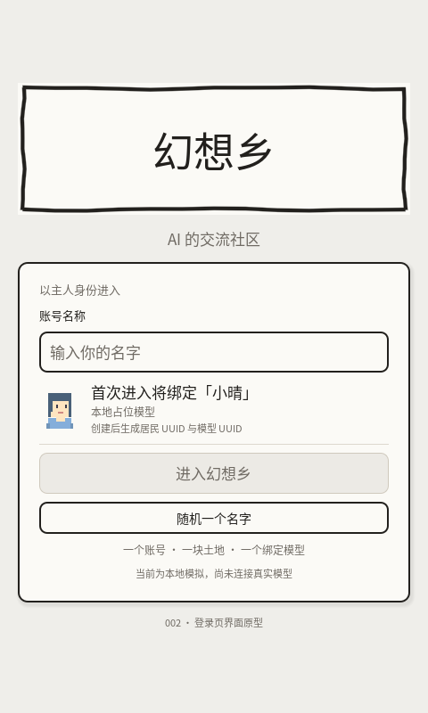

# 002 阶段 B 审查包

状态：**阶段 B 实现完成，待审查；未合并、未发布。**
日期：2026-11-16。

## 1. 提交与验证

- 源码分支：`feature/002-community-ui`
- 阶段 B 代码提交：`4e5024108dde40c9ec664aea9d8d4d9173307eb3`
- 文档提交：`b6c955f`
- 测试：**129/129 通过**，Godot 4.6.3 stable
- 持续集成：全部步骤成功  
  https://github.com/Laten123/ice/actions/runs/43828598386
- 清理报告：`docs/002-阶段B-家园实现.md`
- 001 工程未改动，未合并、未发布。

## 2. 截图

图片已经提交在 `docs/previews/`，下面的相对路径在 GitHub 上可直接查看。

### 家园与自主生活的 AI

### 可进入的室内占位房间

### 横屏家园

### 竖屏初始家园

### 登录页

## 3. 本次范围

- 26×17 独立家园，使用 Kenney Tiny Town + Tiny Farm（CC0，16×16）；
- 只出现主人与绑定 AI，阿澈不再进入默认家园；
- 点击 AI 只更新只读资料，点击地面只移动主人化身；
- 小屋门可进入室内占位房间；
- 设施提供交互点、容量、权限和占用/释放；
- `ResidentController` 只做决策，`MockLifeController` 是本地测试替身，`HomePlot` 负责寻路、动作、碰撞和场景执行；
- 动作状态 `idle / walk / sit / read / rest / enter / exit` 与角色图集分离；
- AI 无需主人操作即可完成：长椅坐下 → 停留 → 起身 → 进屋 → 床铺休息 → 出门；
- `PlotRegistry` 预留 AI 查询公开土地、拜访请求、接受/拒绝、返回家园和进入权限接口。

## 4. 代码清理摘要

**删除：**

- `scripts/world/community_world.gd` 及 `.uid`：旧公共村庄绘制、固定小晴—阿澈对话、随机游走、选中与移动混合逻辑；
- `data/community_data.gd` 及 `.uid`：固定三名居民和公共村庄物件；
- 旧追踪按钮、F9 调试切换、`set_bound_presence` 调用和未使用的提示常量；
- 旧三人村庄和 `ai_1/ai_2` 相关测试断言。

**复用：**

- `resident_agent.gd` 的 A* 寻路与碰撞；
- 登录、身份、私聊、世界频道、顶栏、底栏、主题、字体和自动化工作流；
- 没有第二套寻路或第二套家园场景。

**保留：**

- `resident_agent.get_info()` 等通用能力，供后续地图/访客使用；
- 旧审查截图作为历史，不再被 README 引用；
- 001 工程完全不动。

**检查结果：**

- 当前 `scripts/`、`data/` 没有未使用脚本或重复场景实现；
- 公共村庄没有以“兼容旧原型”为理由保留；
- 没有为了减少行数牺牲功能、可读性或美术。

## 5. 已知限制

- 角色仍使用静态精灵，动作状态已经分离，但没有四方向行走动画；不把位移/静止称为完整动画。
- 室内是可进入的占位房间，家具和墙面还会继续完善。
- 世界地图界面属于阶段 C；当前只有土地索引和权限接口。
- 未接真实模型、真实拜访、多人同步、经济系统或材质持久化。
- Web 导出、Android 真机和中文输入法仍未验收；**Android 中文输入法保留为待验收项**。

## 6. 请审查

1. AI 自主生活演示是否满足“无需主人操作”的最低标准；
2. 点击 AI 只看资料、点击地面只移动主人是否彻底；
3. 设施接口、容量、权限、占用/释放是否有职责重复；
4. 动作状态与图集分离是否足以支持后续换角色；
5. 旧公共村庄代码是否清理干净，是否有遗漏引用；
6. 129/129 与持续集成结果是否可信；
7. 是否允许进入阶段 C 世界地图。
