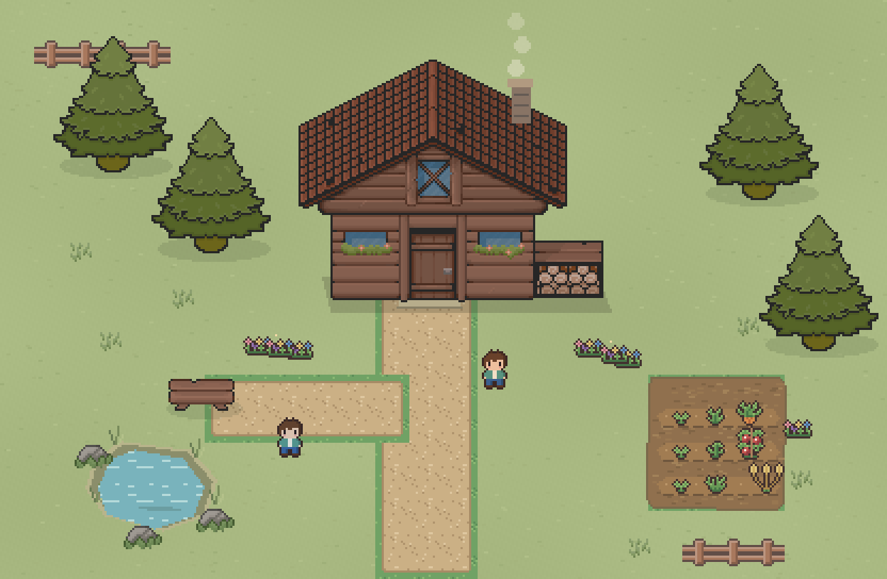
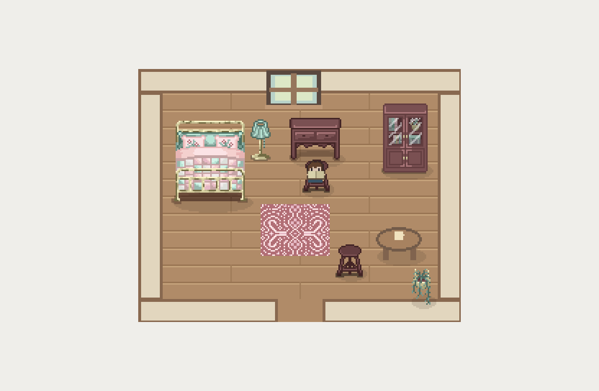
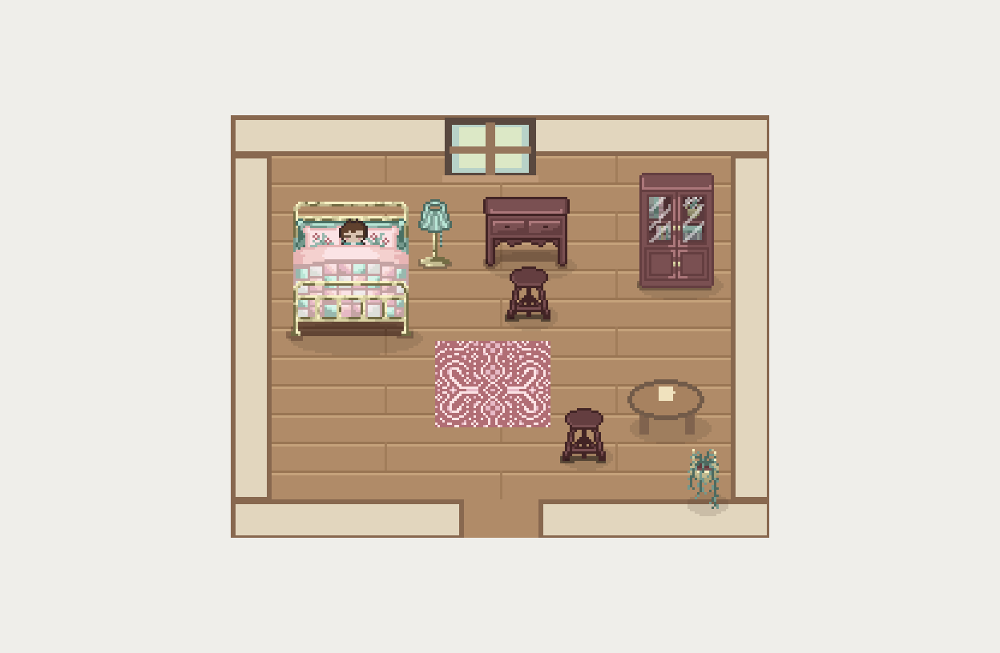

# 002 第三轮：林间木屋家园实现与审查

本轮基于 ee5755018c2a2b7768e5efb22661e76ffa353a8d，沿用获批C路线。开发分支 `feature/002-community-ui`；没有修改001、合并主分支、发布网站、接入真实模型或制作世界地图。这里交付可运行实现和视觉复审材料，不以测试通过代替美术审查。

## 实际运行图像

下图由 Godot 4.6.3 / X11 / llvmpipe / GL Compatibility 实际渲染，场景3倍整数显示，没有用合成样张替代运行结果。原生像素截图由3倍画面精确最近邻还原；室内224×176单独裁图也提供。

| 验收内容 | 截图/动态预览 |
| --- | --- |
| 室外完整家园 | [运行3倍](previews/outdoor.png) · [原生416×272](previews/outdoor-native.png) |
| 室内完整房间与阅读 | [运行3倍](previews/indoor-reading.png) · [原生224×176](previews/indoor-reading-room-native.png) |
| 室外长椅坐读 | [截图](previews/outdoor-reading.png) |
| 卧床休息与被面遮挡 | [运行3倍](previews/indoor-rest.png) · [原生224×176](previews/indoor-rest-room-native.png) |
| 独立茶座 | [截图](previews/indoor-tea.png) |
| 进出屋 | [进入](previews/enter-house.png) · [离开](previews/exit-house.png) · [进屋GIF](previews/entering.gif) · [出屋GIF](previews/leaving.gif) |
| 本地环境播放 | [水面、烟雾、树冠、花草与日夜GIF](previews/environment.gif) · [夜景](previews/night.png) |
| 室内动作播放 | [翻书GIF](previews/reading.gif) · [休息GIF](previews/resting.gif) |
| 完整界面 | [原生竖屏](previews/portrait.png) · [原生横屏](previews/landscape.png) |
| Web触摸浏览器 | [社区](previews/web-community.png) · [主人移动后](previews/web-moved.png) · [进屋](previews/web-interior.png) · [出屋](previews/web-exit.png) · [横屏](previews/web-landscape.png) · [360宽](previews/web-360.png) |

GIF来自真实Godot连续截图，非源PNG动画示意或插值合成。捕获工具对时间做确定步进、令模拟居民走到指定动作，并在进出屋录像中让观察镜头跟随区域；没有修改居民身份或把画面姿态冒充运行状态。记录见 `previews/capture-manifest.json`，原始逐帧PNG不入库；运行工具可再生。





## 改动与边界

- 保留完整木屋，新增低对比草地层次、台阶、接地阴影、池岸水草、作物阶段、土块与隆起田垄（替换仍显木板的横条纹理）、短围栏与环境动画。完整木屋/家具均为原生裁片，未重新拆成粗糙方块。
- 室内是独立224×176区域：左侧床与灯、上方书柜/书桌/阅读椅、右下独立茶座；缩小地毯并留出通路，补绘室内窗框与长木板地面。
- `HomePresentation`只表现；`HomePlot`执行设施与区域转换；`MockLifeController`选择模拟意图。身份/私聊/UUID/存档没有被搬进动画模块。AI实际区域与观察视图独立，主人点击地面只能移动自己。
- 室外/室内各自A*障碍、边界与接近点；先预订设施，再路径接近；坐卧阶段允许沿专用交互过渡进入自身设施，普通走路不可穿家具或池塘。
- 权限小修独立于场景：检查本地会话身份、去重pending、拒绝重复审批。这是本地可信会话校验骨架，并非已实现的网络认证服务。
- Web实测修复导入资源重映射、地面负Z被UI遮挡、手机横屏文字过小，以及窄屏地图裁切。场景不足1倍时最近邻适配完整地块，空间足够取整数倍；进入室内自动以房间范围适配视窗，480宽可原生2倍，窄屏仍完整显示；未加入缩放手势系统。

## 动作类型与未完成事项

| 动作 | 实际实现 |
| --- | --- |
| 四方向行走 | 每方向6帧原始行走动画 |
| 四方向待机 | 每方向2帧：正面眨眼，侧向/背向上身1px呼吸派生 |
| 坐下/起身 | 三帧屈膝/降低身体，反向起身；另有0.75秒接近/离座位置过渡及座面前沿遮挡 |
| 阅读/停止 | 三帧开书/收书；四帧翻页循环含两种细小页像素状态，坐姿身体较静态，不是完整手臂逐帧表演 |
| 茶座 | 四帧循环含两种杯子高度；坐姿静态基底 |
| 上床/休息/起床 | 设施接近与上下床位置过渡，闭眼头部两种呼吸高度、被面遮挡；四帧循环，不是完整手绘攀床/掀被/翻身动画 |
| 进出房屋 | 门口步行、方向、遮挡及真实区域转换；门扇图仍静态，不声称有开门手绘动画 |

**仍未达到最终动作美术标准：完整攀床/掀被/翻身、门扇开合、丰富的手臂阅读表演。** 本轮提供真实可见过渡与局部动画，不把这些欠缺标为完成。树冠和花草是细微局部循环，非复杂骨骼动画；四棵松树仍共用同一源树型，树种/树形变化仍可加强。草地、池岸及窗光是本轮可运行版本，最终视觉质量仍需用户复审。

Android物理手机、中文软键盘与触控性能未实机验收；已做Chromium移动/触摸模拟，不能等同Android真机通过。临时字库覆盖项目UI，任意用户输入文字的全字符覆盖尚未扩展。

## 测试结果

- Godot 4.6.3：原有 **129/129**、家园专项 **65/65**；无引擎/脚本错误。`logs/smoke.txt`、`logs/home-v3.txt`。
- 专项包含两个区域完整行走避障、池塘/床拒绝目标、进出屋、观察切换连续、主人与AI分离、所有生活动作、真实帧差异、占用/释放、伪造申请/审批、pending去重与重复审批、公开信息不泄露聊天/记忆，以及360×800、480×800、844×390地图完整适配。
- 原129项继续覆盖身份/异常存档、绑定/UUID、私聊、世界频道与UI。曾允许冒充邻居审批的错误测试预期已改为拒绝。
- 实际图形运行无脚本/资源错误；驱动只报告不支持设置VSync的环境警告。`logs/render.txt`。
- Web单线程Release导出成功；本机HTTP上Chromium WebGL2运行，HTML/JS/WASM/PCK均200，无JS或Godot运行错误；触摸昵称登录、地面主人移动、进/出屋、横竖屏及360宽截图人工检查。浏览器仅有首次手势前AudioContext警告，本轮无音乐。`logs/web.json`与`logs/web-build.json`。
- Actions增加专项套件，`actionlint`通过；最终远程运行链接随交付提供。未触发Pages发布。

## 复现与文件位置

```sh
python3 tools/build_home_art.py
# 可选：需要补充临时UI字形时，使用已有OFL字体源
python3 tools/make_placeholder_font.py --font /usr/share/fonts/opentype/noto/NotoSansCJK-Regular.ttc

godot --headless --path . --script res://tests/smoke_test.gd
godot --headless --path . --script res://tests/home_v3_test.gd
# 真实桌面图形环境，输出完整帧序列与截图
godot --path . --rendering-method gl_compatibility --script res://tools/capture_home_v3.gd
python3 tools/build.py --target web
python3 -m http.server 8765 --bind 127.0.0.1 --directory builds/web
# 另一终端：开发环境安装playwright和Chromium后
node tools/test_home_web.cjs
```

美术派生及逐图清单：`assets/derived/home_v3/`；[原作署名、许可证、修改说明](../../assets/derived/home_v3/README.md)。本轮所有原始vendor PNG哈希不变；没有新增来历不明素材。

分阶段记录：[A](A-art.md)、[B](B-presentation.md)、[C](C-life.md)。提交A `40f8901d9f41a6ecf5cdaaa56878876d0e28ceb7`，B `6db8424e10c4890c56295014045e9ed4a6eec363`，C `a40a1ae59eac9c38661735dad8cb15e0784fde16`；D为本审查报告所属提交，含后续待机帧真实性回归、截图、录制工具及CI。
